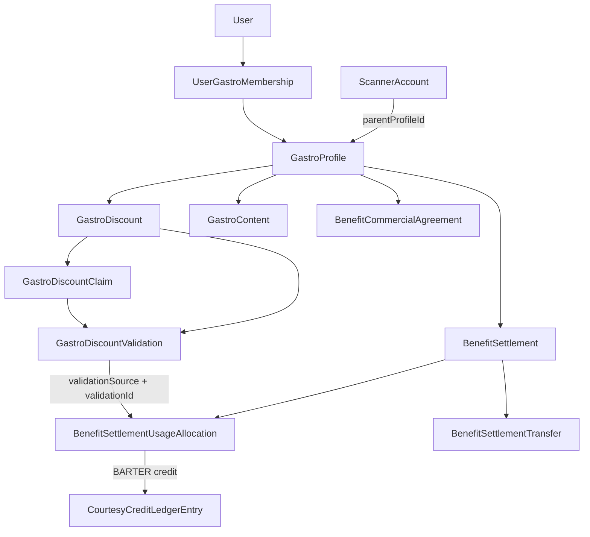

# V3.3 — Gastronomía Expansion Discovery Audit

**Tipo:** auditoría técnica de discovery (sin implementación)  
**Fecha:** 2026-10-22  
**Alcance:** vertical Gastro (multi-local, scanner, taxonomía, descuentos, publicaciones, Etapa 9)  
**Fuente de verdad:** código actual > documentación previa de Stage 4/5/6/9

---

## 1. Executive summary

**Qué ya existe**

- Multi-local real: `GastroProfile` + `UserGastroMembership`, creación de locales adicionales (`POST /gastro/locations`), selección de local vía `?profileId=` + `GastroActiveLocationContext`, aprobación ADMIN dedicada (`PENDING → ACTIVE`) separada del toggle `ACTIVE ↔ SUSPENDED`.
- Scanner V3 por local: `ScannerAccount.parentProfileType=GASTRO` + `parentProfileId`; validación QR y shortCode pasan por `assertScannerCanAccessGastroDiscount` comparando `discount.gastroProfileId === account.parentProfileId`.
- Descuentos con lifecycle completo (`PENDING_REVIEW` → `COMMISSION_NEGOTIATION` → `ACTIVE`, `pendingUpdate`, archive, QR Studio template, claims/validations).
- Subcategorías N:N vía `EventSubcategory` en el `publicEvent` del perfil (legacy `GastroProfile.subcategoryId` / `Event.subcategoryId` como primary).
- Tags vía `ContentTag` + `EventTag` en el public event (catutilizable; no hay `GastroProfileTag`).
- `GastroContent`: modelo de publicaciones múltiples por perfil (title/body/imageUrl/status/sortOrder), portal GASTRO parcial, render público.
- Etapa 9 completa a nivel **partner (`GastroProfile`)**: agreements, settlements, allocations con snapshot, transfers CASH, courtesy ledger BARTER.

**Qué está parcial**

- Aislamiento multi-local en algunos paths (validaciones UI, reviews, endpoints legacy event-scoped, admin `loadDiscount` ignora `profileId` de ruta).
- Publicaciones: sin delete/archive dedicado, sin galería multi-imagen por post, sin ADMIN moderation.
- Métricas operativas por descuento: claims + validationCount existen; series temporales / atribución scanner limitadas.
- Reportes económicos por descuento: trazabilidad validation→allocation **sí**; transferencias CASH y débitos BARTER **no** atribuibles a un descuento.

**Qué falta**

- UX de valor comercial al aprobar descuento (no hay vínculo agreement↔discount; el dominio resuelve por vigencia en el partner).
- Galería de publicaciones (hoy 1 `imageUrl`).
- Tests de aislamiento cross-profile scanner Gastro.
- Unicidad DB de settlement `(tenant, vertical, partner, periodKey)` (hoy `findFirst` en app).

**Nivel de riesgo general:** MEDIO–ALTO en aislamiento/auth de paths legacy y en semántica contable por descuento; BAJO en dominio Etapa 9 partner-scoped si se reutiliza sin duplicar.

**¿Expansión incremental?** Sí. No hace falta mega-refactor: extender `GastroContent`, endurecer ownership, reutilizar Etapa 9 + ContentTag + ScannerAccount + gallery JSON pattern.

---

## 2. Repository state

| Campo | Valor |
|---|---|
| Branch | `feat/v1-s03-api-foundation` |
| HEAD | `bf97378` — `fix(v3.3): restore gastro profile approval flow` |
| Working tree | clean (`nothing to commit`) |
| Remote sync | up to date with `origin/feat/v1-s03-api-foundation` |
| Fecha auditoría | 2026-10-22 |

No se cambió de branch. No se modificó código funcional. No hay commit/push de esta tarea.

---

## 3. Gap matrix

| Requisito | Estado | Evidencia | Gap | Migration | Riesgo |
|---|---|---|---|---|---|
| Multi-local | PARTIAL | `GastroOwnershipService`, `gastro-local.service`, `GastroActiveLocationContext`, `AdminProfilesService.approveGastroProfile` | Paths que aún usan “primer membership”; UI validaciones lista descuentos sin `profileId` | NO | MEDIUM |
| Scanner por local | COMPLETE (runtime) / PARTIAL (tests) | `ScannerAccount`, `assertScannerCanAccessGastroDiscount` en QR + shortCode | Deuda de test cross-profile | NO | LOW (código) / MEDIUM (QA) |
| Multi-subcategorías | PARTIAL | `EventSubcategory` + `subcategoryId` legacy; write ADMIN/GASTRO sync a public event | Público/listado a veces solo `subcategoryName` legacy; discovery filters usan OR legacy+junction | NO | LOW |
| Tags | PARTIAL | `ContentTag`/`EventTag` en public event; write `tagIds` en local create/update | No hay FK directa a GastroProfile; filtros discovery por tag gastro limitados | NO | LOW |
| Descuentos | COMPLETE (core) / PARTIAL (isolation edges) | `GastroDiscount.gastroProfileId`, portal + admin lifecycle | Endpoints legacy `/gastro/events/:eventId/discounts`; admin `loadDiscount` no valida path profileId | NO | MEDIUM |
| Métricas descuento | PARTIAL | `GastroDiscountMetricsService`, admin metrics, validations list con `discountId` | Sin series temporales; UI validaciones mezcla locales | NO | LOW |
| Publicaciones | PARTIAL | `GastroContent` multi-row, create/update portal, public list | Sin delete; 1 imagen; ADMIN moderation NO EXISTE | PROBABLE (galería) | LOW |
| Galerías (posts) | MISSING | Profile usa `galleryUrls` Json; content solo `imageUrl` | Galería por publicación | PROBABLE / SÍ si child table | LOW |
| Admin approval (perfil) | COMPLETE | Pending section + dedicated approve/reject; toggle solo ACTIVE↔SUSPENDED en UI | — | NO | LOW |
| Commercial agreement | COMPLETE (partner) | Scope `GastroProfile`; no FK a discount | UX aprobación descuento no integra agreement | NO (salvo scope discount) | MEDIUM (producto) |
| CASH | COMPLETE (settlement) | Transfers + helpers `cashDue/Received/Outstanding` | No atribuible a discount | NO | HIGH (semántica reporting) |
| BARTER | COMPLETE (partner ledger) | CREDIT snapshot vía allocation; DEBIT por campaign | Credit generated por discount sí (vía allocation); consumed/balance no | NO | HIGH (semántica reporting) |
| Reportes por descuento | PARTIAL | Trace validation→allocation inequívoco | Transfers/débitos no por discount | NO para ops; SÍ solo si se exige attribution transfer | HIGH |

Estados: COMPLETE / PARTIAL / MISSING / BLOCKED.

---

## 4. Current domain map

### Entidades reales (Prisma)

```text
User
  └── UserGastroMembership (tenantId, userId, profileId, membershipRole, status)
        └── GastroProfile (tenantId, status, subcategoryId?, publicEventId?, galleryUrls Json?, …)
              ├── GastroDiscount (gastroProfileId?, eventId, status, pendingUpdate, …)
              │     ├── GastroDiscountClaim (qrToken, shortCode, …)
              │     ├── GastroDiscountValidation (discountId, claimId?, …)
              │     ├── GastroDiscountTemplate (1:1 visual)
              │     └── GastroCourtesyCampaign (1:1 opcional)
              ├── GastroContent (gastroProfileId, eventId, title?, body?, imageUrl?, status, sortOrder)
              ├── ScannerAccount (parentProfileType=GASTRO, parentProfileId=GastroProfile.id)  [vía parent, no FK Prisma]
              ├── BenefitCommercialAgreement (gastroProfileId, unitPriceCents, barterMultiplier, validFrom/To)
              ├── BenefitSettlement (gastroProfileId, periodKey, status)
              │     ├── BenefitSettlementUsageAllocation (validationSource, validationId, snapshots, mode)
              │     └── BenefitSettlementTransfer (amountCents, settlement-scoped)
              └── CourtesyCreditLedgerEntry (partner-scoped; sourceAllocationId / sourceCourtesyCampaignId)
```

### Mermaid



### Notas de modelo

- `ScannerAccount` **no** tiene FK Prisma a `GastroProfile`; isolation es lógica (`parentProfileType` + `parentProfileId`).
- Tags/subcategorías multi viven en el **Event** público (`EventTag`, `EventSubcategory`), no en tablas `Gastro*`.
- Agreements/settlements son **partner-scoped** (`gastroProfileId`), no discount-scoped.

---

## 5. Multi-local findings

**Clasificación:** PARCIAL (+ RIESGO en paths legacy)

### Creación de local

| Flujo | Estado inicial perfil | Membership | Evidencia |
|---|---|---|---|
| Signup / apply (`ProfileRegistrationService.createGastroActive`) | `PENDING` | `OWNER` + `ACTIVE` | `profile-registration.service.ts` |
| Portal `POST /gastro/locations` (`createAdditionalLocal`) | `PENDING` | `OWNER` + `ACTIVE` | `gastro-local.service.ts` |
| Admin create location | configurable (`ACTIVE` default) | `ensureOwnerMembership` ACTIVE | `admin-gastro-locations.service.ts` |

**Observación:** la membership nace `ACTIVE` aunque el perfil esté `PENDING`. El “gate” operativo es `GastroProfile.status === ACTIVE` (`GASTRO_OPERATIONAL_PROFILE_STATUSES`), no `MembershipStatus.PENDING`.

### Selección / persistencia de `profileId`

- UI: `GastroActiveLocationProvider` lee `?profileId=` de la URL; si no hay / inválido, elige primer `ACTIVE` o primero de la lista.
- Persistencia: **solo URL** (no localStorage/session DB).
- Backend: `GastroOwnershipService.assertCanManageProfile` / `assertCanOperateProfile` revalida membership/ownership + status.

### Endpoints scoped por `profileId` (query)

- Dashboard, local get/update, discounts list/create, validations list (query opcional), scanners portal.

### Aprobación ADMIN

```text
GET  /admin/profiles/gastro/pending
POST /admin/profiles/gastro/:id/approve  → ACTIVE + memberships ACTIVE + sync público + notify
POST /admin/profiles/gastro/:id/reject   → REJECTED + sync + notify
```

UI: `AdminPendingGastroProfilesSection` (flujo dedicado).

Toggle genérico UI lista locales: solo `active ↔ suspended` (`AdminGastroLocationsPageClient`). **No** se usa para `PENDING → ACTIVE`. El schema de status patch **admite** todos los `ProfileStatus` (incluido PENDING/ACTIVE), pero la UI de listado no aprueba pendientes con ese toggle.

### Gaps multi-local

1. `GastroValidationsContent` llama `listMyDiscounts()` **sin** `profileId` → mezcla descuentos del local default.
2. `review-disputes.gastroPublicEventScope` usa `findFirst` membership → un solo publicEvent.
3. Endpoints legacy event-scoped siguen vivos (`GastroService` + `ApiRepository.gastro.listDiscounts/createDiscount`).
4. Docs Stage 4 mencionaban membership PENDING en aprobación; código real: membership ya ACTIVE al crear; approve solo asegura `updateMany status ACTIVE`.

---

## 6. Scanner findings

**Cross-profile isolation (regla de negocio):** **CUMPLE en runtime para rol SCANNER**.

### Modelo

```prisma
ScannerAccount {
  parentProfileType  ScannerParentProfileType  // PRODUCER | GASTRO | EXCURSION_OPERATOR | RENTAL_LOCATION
  parentProfileId    String                    // GastroProfile.id cuando type=GASTRO
  scannerUserId      @unique
  parentUserId
  isActive
}
```

### Creación

- Portal GASTRO / ADMIN vía `ScannerAccountsService`; portal resuelve `parentProfileId` desde memberships (no confía ciegamente en body admin-only).
- Options: lista de perfiles ACTIVE del usuario con `isPrimary`.

### Validación

- `POST /scanner/gastro-discounts/validate` (roles: SCANNER, ADMIN, GASTRO_OWNER).
- ShortCode → lookup claim → `assertScannerCanAccessGastroDiscount`.
- QR payload → mismo assert antes de redeem.
- Assert: `account.parentProfileType === GASTRO` **y** `discount.gastroProfileId === account.parentProfileId`.

### Caso prohibido (Local A scanner vs Descuento B)

→ **RECHAZADO** (`FORBIDDEN` / scanner scope) si el caller es `Role.SCANNER`.

### Matices / riesgos

| Caso | Resultado |
|---|---|
| SCANNER A1 valida descuento B | Rechazado |
| `GASTRO_OWNER` valida (mismo endpoint) | `assertCanScan` solo exige `hasGastroAccess` — **no** re-chequea profile del descuento |
| ADMIN | Bypass de scope scanner |
| JWT | No embebe `parentProfileId`; se carga de `ScannerAccount` en cada request |

### Tests

- Smoke scope V3.1 (`smoke-v31-scanner-scope.ts`): targets gastro, no cross-profile discount reject.
- **Deuda:** no hay test explícito “Scanner A1 → Descuento B1 → forbidden”.

---

## 7. Taxonomy findings

### Subcategories

| Pregunta | Respuesta |
|---|---|
| ¿`GastroProfile.subcategoryId` legacy? | Sí |
| ¿N:N? | Sí, vía `EventSubcategory` en `publicEventId` (`isPrimary`) |
| Fuente canónica multi | Junction en Event; legacy FK = primary |
| Write ADMIN / GASTRO | `resolveValidatedGastroSubcategories` + `syncGastroPublicEventSubcategories` |
| API response portal | `subcategories[]` + `subcategoryId` |
| Público | A menudo `subcategoryName` (single); tags sí multi |
| Discovery filtros | `subcategoryFilterWhere` OR legacy FK **o** junction |
| Precedente | Mismo patrón que Excursions / Events |

**Gap:** listados públicos/carruseles pueden mostrar solo primary; write paths ya soportan multi.

### Tags

| Pregunta | Respuesta |
|---|---|
| Modelo | `ContentTag` (catálogo tenant) + `EventTag` |
| Relación GastroProfile | Indirecta vía `publicEventId` |
| Creación libre vs catálogo | Catálogo ADMIN (`/admin/tags`); assign por `tagIds` |
| Portal GASTRO | `tagIds` en create/update local |
| Público | `ContentTagChips` en ficha |
| ¿Nuevo modelo? | **No.** Reutilizar `ContentTag` + sync a public event |

Diferencia estricta: **Subcategory** = taxonomía discovery; **Tag** = atributos (Pet Friendly, Vegano, etc.).

---

## 8. Discount lifecycle findings

### Estados Prisma

`PENDING_REVIEW` | `COMMISSION_NEGOTIATION` | `APPROVED` | `ACTIVE` | `REJECTED` | `CANCELLED` | `EXPIRED`

### Aprobación create (ADMIN)

```text
UI Admin discount detail
→ POST .../approve (profile-scoped o ticket routes)
→ AdminGastroService.approve
→ status ACTIVE + genera qrToken
→ audit + notify followers + lifecycle notification
```

- Desde `PENDING_REVIEW` o `COMMISSION_NEGOTIATION`.
- Requiere publicación con ≥1 imagen (`displayImageUrls`).
- Transición concreta de aprobación: **→ `ACTIVE`** (no se queda en `APPROVED` como estado final típico de approve).

### pendingUpdate

- Owner envía edición → JSON `pendingUpdate` + timestamps.
- ADMIN `approvePendingEdit` / `rejectPendingEdit` aplica o descarta sin recrear descuento.
- El descuento publicado sigue ACTIVE durante la revisión de edit.

### Aislamiento portal

- `listMyDiscounts(profileId)` filtra `gastroProfileId` (+ OR `eventId` del public event — compat legacy).
- `assertOwnDiscount` exige operate membership del `gastroProfileId` del row.
- Create exige `profileId` explícito si hay N>1 locales operativos.

### Gaps

- Legacy `GastroService` event-scoped sin ownership por profile (sigue expuesto).
- Admin `loadDiscount(tenantId, _profileId, discountId)` **ignora** `_profileId` → posible detalle de descuento bajo URL de otro local (misma tenant).

---

## 9. Operational metrics findings

### Disponible hoy

| Capacidad | ¿Existe? | Dónde |
|---|---|---|
| Claims por descuento | Sí | `GastroDiscountMetricsService.buildSummaryForDiscount` |
| Validation count | Sí | count `GastroDiscountValidation` |
| Listado validaciones + filtros fecha/`discountId`/`profileId` | Sí | `GET /gastro/validations` |
| ShortCode / QR en claim | Sí (campos claim) | summary maps claims |
| Series temporales | No | — |
| Atribución scanner user en metrics UI | Limitada | validation tiene `userId` opcional |
| Scope discountId | Sí | |
| Validación gastroProfileId en metrics | Parcial | admin metrics por profile+discount; portal summary por discount ownership |

### UI

- Portal: descuento detail / validations page.
- Admin: metrics expand en tabla + discount detail.

### Notas performance (no optimizar ahora)

- `listPendingDiscounts` puede N+1 al resolver profile names.
- Summaries cargan todos los claims del descuento.

---

## 10. GastroContent findings

Respuestas explícitas:

| Pregunta | Respuesta |
|---|---|
| ¿Qué representa? | Bloques editoriales/imagen del local (publicaciones) |
| ¿Pertenece a GastroProfile? | Sí (`gastroProfileId`) + también `eventId` (public event) |
| ¿Más de uno por perfil? | **Sí** |
| ¿Publicación real o auxiliar? | Publicación real ligera (no CMS completo) |
| title / body / imageUrl | Sí / Sí / Sí (single) |
| status | `DRAFT` \| `PUBLISHED` \| `INACTIVE` |
| sortOrder | Sí |
| timestamps | createdAt / updatedAt |
| soft-delete/archive | **No** (INACTIVE ≈ ocultar) |
| multiple posts? | **Sí** |
| multiple images? | **No** (1 `imageUrl`) |
| profile scope? | Sí |
| portal GASTRO? | Create + update (+ status); sortOrder en create default |
| ADMIN? | Mismos endpoints si role ADMIN; **sin** pantalla/moderation dedicada → **NO EXISTE** moderación |
| public render? | `listPublishedForProfile` en ficha `/gastronomicos/[id]` |

**Recomendación:** extender `GastroContent` (no crear modelo paralelo), alineado a §36.

---

## 11. Gallery architecture findings

### Patrones existentes

| Patrón | Dónde | Orden | Upload | Límite | Cleanup |
|---|---|---|---|---|---|
| `Json` / `String[]` (`galleryUrls`) | `GastroProfile`, `HotelProfile`, Excursion-ish fields | orden de array | GCS URLs / data URLs vía forms | shared max ~30 gastro local | no cleanup automático de GCS |
| `displayImageUrls` / `submittedImageUrls` Json | `GastroDiscount` | array | admin publication | max 30 schema | no |
| Tabla hija `EventMedia` | Event ticketing media | `sortOrder` + `deletedAt` soft | media pipeline eventos | por filas | soft-delete |

### Recomendación para `GastroContent`

**Reutilizar patrón Json `String[]` / `galleryUrls`** (como el local gastro y descuentos), no `EventMedia`, salvo que se necesite soft-delete por asset y metadata rica.

- Consistencia con ficha gastro y discount images.
- Extensión natural: `imageUrls Json?` o `galleryUrls Json?` en `GastroContent`, manteniendo `imageUrl` como cover/legacy.

**Migration:** **PROBABLE** (nuevo campo Json) o **SÍ** si se elige tabla hija tipo `GastroContentImage`.

---

## 12. Public Gastro page findings

Ruta: `apps/web/app/(public)/gastronomicos/[id]/page.tsx` → client → `GastroLocationDetailView` → `GastroPublicDetailContent`.

Data: public API locations service → Prisma profile + content published + tags + discounts query separada.

### Estructura actual (orden)

1. Hero (banner, logo, nombre, summary, subcategoryName, follow, rating)
2. About / descripción
3. Tags
4. Descuentos
5. Editorial (`GastroContent` published)
6. Galería del **local** (`bannerUrl` + `galleryUrls`)
7. Aside: actions, hours, links, mapa modal, reviews

### Integración futura de múltiples publicaciones

Sin rediseñar dominio: el bloque editorial **ya** itera `location.content[]`. Mejoras serían UX (jerarquía Hero → Descripción → Publicaciones → Descuentos) y enriquecer cada item con galería — **no** hace falta nueva ruta pública.

---

## 13. Stage 9 accounting findings

### Agreements

- Scope: `tenantId` + `vertical` + (`gastroProfileId` XOR `excursionOperatorId`).
- Campos reales: `unitPriceCents`, `barterMultiplier`, `currency`, `validFrom`, `validTo?`, notes; **no** enum `status` — vigencia por fechas.
- APIs: `GET/POST /admin/benefit-agreements`, close, replace, notes, partner-history.
- UI: `/admin/liquidaciones/acuerdos`.
- Resolución al liquidar: `resolveSettlementAgreementForValidation(agreements, validatedAt)` por calendario.
- Replace/close preservan filas históricas; allocations guardan snapshot.

### Settlements

- Partner + `periodKey`; status `OPEN | PARTIALLY_ALLOCATED | ALLOCATED | CLOSED`.
- Unicidad: **aplicación** `findFirst` (no `@@unique` Prisma encontrado).
- Generate/refresh/allocate/close; **no reopen**.
- UI: `/admin/liquidaciones`, detail `[id]`.

### Allocations

- `validationSource` + `validationId` **unique**.
- Snapshots: `unitPriceCents`, `barterMultiplier`, `baseAmountCents`, `currency`, `agreementId`, `mode` CASH|BARTER.

### Transfers

- Settlement-scoped; helpers `computeCashDueCents`, `computeCashReceivedCents`, `computeCashOutstandingCents`, `deriveCashCollectionStatus`.
- Overpay guard en register transfer.

### Courtesy ledger

- Partner-scoped balance.
- CREDIT_FROM_SETTLEMENT ↔ `sourceAllocationId` (unique).
- DEBIT_COURTESY ↔ campaign (no discount id directo).
- Ajustes / reversals existen.

---

## 14. Discount → accounting traceability

**Camino real:**

```text
GastroDiscount.id
  → GastroDiscountClaim.discountId
  → GastroDiscountValidation.discountId (+ claimId)
  → BenefitSettlementUsageAllocation
       where validationSource = 'GASTRO_DISCOUNT_VALIDATION'
         and validationId = GastroDiscountValidation.id
  → BenefitSettlement (partner GastroProfile + periodKey)
  → agreementId + snapshots en allocation
  → (BARTER) CourtesyCreditLedgerEntry.sourceAllocationId
```

**¿Query inequívoca de allocations de un GastroDiscount?**

**SÍ, CON LIMITACIONES**

- **Sí** para allocations: join validation → discountId.
- Limitaciones:
  - Transferencias CASH no tienen `discountId` / `allocationId`.
  - Débitos ledger no apuntan al descuento origen del crédito.
  - Validaciones sin `claimId` no son eligible para settlement (`isGastroValidationEligibleForSettlement`).

---

## 15. Commercial agreement at discount approval

### Alternativas vs dominio real

| Opción | Encaje |
|---|---|
| A — crear agreement del perfil al aprobar | Posible UX, pero agreements son **tarifas del partner en el tiempo**, no del ticket |
| B — seleccionar agreement existente | Compatible si se muestra vigencia; no cambia allocation engine |
| C — scope agreement por descuento | **Rompe** modelo actual; migration grande; solo si tarifas por producto son requisito duro |
| D — sin vínculo; resolución en allocation | **Es el diseño actual** |
| E — híbrido | Al aprobar: opcionalmente **ensure/replace** agreement del perfil **si** el admin carga un unit price distinto al CURRENT; no FK discount |

### Recomendación

**E (derivada de D + UX):**

1. No crear `GastroDiscount.unitPrice`.
2. No FK agreement→discount salvo requisito futuro inequívoco.
3. En UI de aprobación: mostrar agreement CURRENT del `GastroProfile`; permitir “registrar/actualizar tarifa” llamando create/replace de `BenefitCommercialAgreement`.
4. Liquidaciones siguen resolviendo por `validatedAt` ∈ `[validFrom, validTo]`.
5. Históricos ya preservados en allocation snapshots.

Si el negocio exige tarifas **distintas por descuento simultáneos**, ahí sí evaluar **C** (migration SÍ) — hoy el dominio **no** lo soporta.

---

## 16. Per-discount economic reporting feasibility

| Métrica | Derivable hoy | Fuente | Exacta o aproximada | Limitación |
|---|---|---|---|---|
| Tickets usados | Sí | `GastroDiscountValidation` / claims USED | Exacta | — |
| Unit price | Sí (al allocate) | Allocation snapshot / agreement at validatedAt | Exacta post-allocation; pre-allocation = agreement vigente en validatedAt | Sin allocation aún no hay snapshot |
| Economic base | Sí | Σ `baseAmountCents` allocations del discount | Exacta | Solo usos ya allocated |
| CASH usages | Sí | allocations mode=CASH ∩ discount | Exacta | — |
| CASH due | Sí | Σ base CASH allocations del discount | Exacta a nivel usos | ≠ cash del settlement si se prorratea mal |
| CASH transferred | **No exacto** | Transfers son settlement-wide | No atribuible | **Limitación semántica** |
| CASH remaining | **No exacto** por discount | settlement cashDue − received | Solo a nivel settlement/partner | No inventar prorrateo |
| BARTER usages | Sí | allocations mode=BARTER ∩ discount | Exacta | — |
| BARTER base | Sí | Σ base BARTER | Exacta | — |
| Multiplier | Sí | allocation.barterMultiplier snapshot | Exacta | — |
| Credit generated | Sí | ledger CREDIT con `sourceAllocationId` ∈ allocations del discount | Exacta | — |
| Credit consumed | **No exacto** | DEBIT_COURTESY partner-level | No atribuible a discount | Sin política FIFO en código |
| Credit balance | Partner only | ledger sum | Exacta partner / N/A discount | — |

**Regla:** no reportar `cash + barter credit = total cobrado`.

---

## 17. Tenant / authorization risks

| Severidad | Archivo | Flujo | Riesgo | Recomendación |
|---|---|---|---|---|
| HIGH | `admin-gastro.service.ts` `loadDiscount` | Admin discount by `:profileId/:discountId` | `profileId` de ruta ignorado; IDOR intra-tenant entre locales | Assert `row.gastroProfileId === profileId` (o redirect canónico) |
| HIGH | `scanner-gastro-discount.service.ts` | `GASTRO_OWNER` validate | Owner multi-local puede validar cupón de **otro** suyo local (o cualquier gastro access) sin match profile | Para owner: exigir membership del `discount.gastroProfileId` |
| MEDIUM | `gastro.service.ts` | `/gastro/events/:eventId/discounts*` | Legacy sin profile ownership fino; create asigna “primer” membership ACTIVE | Deprecar / proxy a portal discounts |
| MEDIUM | `GastroValidationsContent.tsx` | list discounts sin profileId | UI mezcla locales | Pasar `profileId` activo |
| MEDIUM | `review-disputes.service.ts` | gastro reviews scope | Solo primer membership ACTIVE | Scope por `profileId` |
| LOW | `BenefitSettlement` uniqueness | generate concurrent | Race posible sin unique DB | `@@unique` migration futura |
| LOW | Content update | ownership via event→profile | OK si membership; ADMIN bypass | Mantener |

No se encontraron `findUnique({ where: { id } })` obvios sin `tenantId` en los flujos Stage 9 auditados (usan `require(tenantId, id)`). Admin gastro discount path es el hallazgo principal de path-param trust.

---

## 18. Migration impact

| Gap | Migration | Motivo |
|---|---|---|
| Endurecer ownership / UI profileId | NO | Solo API/UI |
| Tests cross-profile scanner | NO | Scripts/tests |
| GastroContent gallery Json field | PROBABLE | Alter column Json |
| GastroContent child images table | SÍ | Nueva tabla |
| Agreement scoped by discount | SÍ | FK + reglas overlap |
| Discount economic counters | NO (evitar) | Derivar de Etapa 9 |
| Settlement unique partner+period | PROBABLE | `@@unique` |
| ContentTag for gastro | NO | Ya existe |
| Soft-delete GastroContent | PROBABLE | campo deletedAt/archivedAt opcional |

---

## 19. Test coverage

| Dominio | Unit | Integration | E2E/Smoke | Manual QA | Gap |
|---|---|---|---|---|---|
| Multi-local ownership helpers | Sí (`test-gastro-multi-local.util`) | Parcial | — | Stage 4 closing | API isolation e2e |
| Membership / pending approval | — | Parcial (código approve) | — | Admin pending UI | Automate approve flow |
| Scanner cross-profile gastro | — | — | Scope smoke incompleto | — | **Falta caso A vs B** |
| Discount ownership | Parcial | edit/pending scripts | — | Stage 5 | Legacy endpoints |
| pendingUpdate | Sí scripts | Sí | — | — | — |
| GastroContent | — | — | — | Manual portal | CRUD + public |
| Metrics | util metrics | — | — | — | — |
| Agreements | Sí util | — | — | Admin UI | — |
| Settlements / allocations | Sí domain/hardening | — | — | Admin UI | — |
| Cash transfers | Sí util | — | — | — | — |
| Barter ledger | Sí util + courtesy funding | — | — | — | — |
| Tenant isolation | parcial smokes storage | — | — | — | Gastro-specific matrix |

---

## 20. Technical debt (relevante a la expansión)

1. Endpoints legacy event-scoped de descuentos aún en controller + ApiRepository.
2. Admin discount loader confía en discountId+tenant, no en path profileId.
3. Validaciones portal: query keys OK con profileId en hook, pero selector de descuentos no filtra por local.
4. Reviews gastro multi-local incompleto.
5. Settlement uniqueness solo en aplicación.
6. `GastroContent` atado a `eventId` obligatorio (acoplamiento a public event) — viable pero rígido si un día hay content sin public event.
7. Membership ACTIVE + profile PENDING es correcto operativamente pero fácil de malinterpretar en docs.

---

## 21. Reusable architecture

Reutilizar tal cual:

- `ScannerAccount` + `assertScannerCanAccessGastroDiscount`
- `GastroOwnershipService` / portal `profileId` query pattern
- `ContentTag` + `EventTag` + `syncGastroPublicEventTags`
- `EventSubcategory` + gastro subcategory helpers
- `GastroDiscount` lifecycle + `pendingUpdate` + `GastroDiscountTemplate`
- `BenefitCommercialAgreement` + replace/close + calendar resolution
- `BenefitSettlement*` + allocation snapshots
- `CourtesyCreditLedgerEntry` + barter materialize
- Money helpers (`moneyCents*`, barter credit compute)
- Gallery pattern `galleryUrls` Json (perfil/descuentos)
- `GastroContent` como entidad de publicaciones
- Shared schemas gastro + benefit-* + scanner-*
- Admin UI liquidaciones (`/admin/liquidaciones/*`) embebible conceptualmente bajo Local → Comercial/Liquidaciones

---

## 22. Things we must NOT duplicate

| Área | No crear |
|---|---|
| Scanner | Segundo modelo de “empleados scanner” sin `parentProfileId` |
| Tags | `GastroTag` paralelo a `ContentTag` |
| Subcategories | `GastroProfileSubcategory` si EventSubcategory ya cubre discovery |
| Discount accounting | `GastroDiscount.unitPrice` / paymentTotal / barterTotal |
| Cash totals | Contadores denormalizados de transferred-by-discount |
| Barter | Ledger paralelo o balance por descuento inventado |
| Uploads | Pipeline distinto a GCS image upload existente |
| Settlements | Settlement por descuento que ignore partner period model |

---

## 23. Recommended roadmap

Orden según dependencias reales (aislamiento → dominio contenido → economía UX → reporting → QA).

### Etapa G1 — Aislamiento multi-local hardening

**Objetivo:** Local A ≠ Local B en todos los paths operativos.  
**Dependencias:** ninguna.  
**Prisma:** no  
**API:** assert profile en admin discount load; ownership en validate GASTRO_OWNER; deprecar/bloquear legacy event discount writes  
**Shared:** opcional error codes  
**Web Gastro:** validations discounts con `profileId`; revisar reviews scope UI  
**Web Admin:** guardrails profileId en rutas descuento  
**Scanner:** test only  
**Public:** no  
**Tests:** cross-profile scanner + owner validate + admin IDOR  
**Migration:** NO  
**Riesgo:** MEDIUM  
**Cierre:** Scanner A1 rechaza B1; owner no valida cross-local; admin URL mismatch 404/403; validations UI scoped.

- G1.1 Admin `loadDiscount` profile assert  
- G1.2 Scanner/owner validate profile match  
- G1.3 Portal validations + reviews profile scope  
- G1.4 Tests aislamiento  

### Etapa G2 — Taxonomía pública consistente

**Objetivo:** Multi-subcategory + tags visibles/filtrables de punta a punta.  
**Dependencias:** G1 opcional.  
**Prisma:** no  
**API:** public detail devolver `subcategories[]` (no solo name)  
**Shared:** response schemas  
**Web Gastro/Admin:** ya tienen multi-select — verificar parity  
**Public:** chips multi + filters  
**Tests:** filter OR legacy/junction  
**Migration:** NO  
**Riesgo:** LOW  
**Cierre:** ficha y discovery reflejan N subcategorías y N tags.

### Etapa G3 — Publicaciones GastroContent v1.5

**Objetivo:** CRUD completo portal + galería por post + render público mejorado.  
**Dependencias:** G1 recomendada.  
**Prisma:** PROBABLE (`galleryUrls`/`imageUrls` Json)  
**API:** delete/archive; list by profileId; optional reorder endpoint  
**Shared:** schemas content gallery  
**Web Gastro:** UX create/edit/hide/reorder/preview  
**Web Admin:** list/view mínimo (sin moderation engine) — opcional  
**Public:** sección Publicaciones antes/después de descuentos según diseño  
**Scanner:** no  
**Tests:** content ownership + public only PUBLISHED  
**Migration:** PROBABLE  
**Riesgo:** LOW  
**Cierre:** N posts con galería; hide via INACTIVE; ownership profile-scoped.

- G3.1 Extender modelo imagen(es)  
- G3.2 API delete/reorder  
- G3.3 Portal UX  
- G3.4 Public section polish  

### Etapa G4 — Métricas operativas por descuento

**Objetivo:** Local → Descuento → métricas usables.  
**Dependencias:** G1.  
**Prisma:** no  
**API:** opcional aggregations by day (derived)  
**Shared:** response DTOs  
**Web Gastro/Admin:** páginas métricas  
**Migration:** NO  
**Riesgo:** LOW  
**Cierre:** claims/validaciones/filtros fecha por discountId + profileId.

### Etapa G5 — Acuerdo comercial en aprobación de descuento

**Objetivo:** UX admin registra unit price / multiplier sin romper Etapa 9.  
**Dependencias:** Stage 9 existente.  
**Prisma:** NO (salvo producto force scope-by-discount → entonces SÍ, etapa separada)  
**API:** compose approve + optional agreement create/replace  
**Shared:** request body opcional en approve  
**Web Admin:** form en approve discount  
**Migration:** NO  
**Riesgo:** MEDIUM (producto)  
**Cierre:** aprobar 20% almuerzo + $5000 crea/reemplaza agreement del perfil; allocations futuras usan snapshot correcto; históricos intactos.

### Etapa G6 — Reporting económico por descuento (honesto)

**Objetivo:** Reportes exactos donde el dominio permite; explícitos donde no.  
**Dependencias:** G5.  
**Prisma:** NO  
**API:** report endpoint derived joins validation→allocation  
**Shared:** DTOs + labels de limitaciones  
**Web Admin:** bajo Local → Descuento → Comercial/Liquidaciones (reutiliza liquidaciones)  
**Migration:** NO  
**Riesgo:** MEDIUM  
**Cierre:** tabla métricas exactas; CASH transferred / credit consumed marcados N/A a nivel discount.

### Etapa G7 — QA / hardening

**Objetivo:** matriz tests + unique settlement opcional.  
**Dependencias:** G1–G6.  
**Prisma:** PROBABLE unique settlement  
**Tests:** matrix §19  
**Migration:** PROBABLE  
**Riesgo:** LOW  
**Cierre:** smokes cross-profile + accounting regression verdes.

---

## Anexo — Respuestas a las 20 preguntas de decisión

1. **Hecho:** multi-local core, scanner por profile, discount lifecycle, Etapa 9 partner, ContentTag, GastroContent básico, metrics claims.  
2. **Solo UI:** multi-subcat/tags parity pública; métricas screens; agreement form en approve; reorder content UX.  
3. **Solo API:** asserts ownership; public subcategories array; content delete; discount economic report derived.  
4. **Dominio:** galería content (campo); opcional agreement-by-discount solo si negocio lo exige.  
5. **Migration:** galería content PROBABLE/SÍ; agreement-by-discount SÍ; settlement unique PROBABLE.  
6. **Scanner aislado por local:** **Sí para SCANNER**; gap en GASTRO_OWNER validate + deuda tests.  
7. **Multi-subcategorías:** write sí; lectura pública/listados parcial.  
8. **Tags:** infraestructura reutilizable sí (`ContentTag`).  
9. **`GastroContent` hoy:** posts editoriales/imagen ligados a profile+public event.  
10. **Múltiples publicaciones:** sí.  
11. **Galerías:** extender con Json URLs (patrón gastro), no segundo CMS.  
12. **Métricas por descuento:** sí (claims/validations); series no.  
13. **Validación → allocation:** `GASTRO_DISCOUNT_VALIDATION` + `validationId`.  
14. **Reportes económicos exactos por descuento:** parcial (usos/base/CASH|BARTER allocated/credit generated).  
15. **No exactos:** CASH transferred/remaining por discount; credit consumed/balance por discount.  
16. **Valor comercial en approve:** ensure/replace `BenefitCommercialAgreement` del perfil (opción E).  
17. **¿Relacionar agreement–descuento?** No, salvo requisito de tarifas simultáneas distintas.  
18. **Históricos tarifa:** snapshots en `BenefitSettlementUsageAllocation`.  
19. **Reutilizar Etapa 9:** agreements, settlements, allocations, transfers, ledger, money helpers, admin liquidaciones UI.  
20. **Roadmap:** G1 aislamiento → G2 taxonomía → G3 publicaciones → G4 métricas → G5 agreement UX → G6 reporting → G7 QA.

---

## Anexo — Docs vs código

| Tema | Docs Stage 4/9 | Código actual |
|---|---|---|
| Membership al aprobar | a veces sugiere PENDING→ACTIVE membership | Membership ya ACTIVE al crear; approve hace `updateMany ACTIVE` |
| Scanner isolation | afirmada | Implementada para SCANNER |
| Agreement por discount | no | no |
| GastroContent | poco documentado en Stage 4 | Modelo + API + portal parcial desde migrations 20260522140000 |

**Código > docs.**

---

*Fin del informe de discovery. Sin implementación, sin migrations creadas, sin commit/push.*
